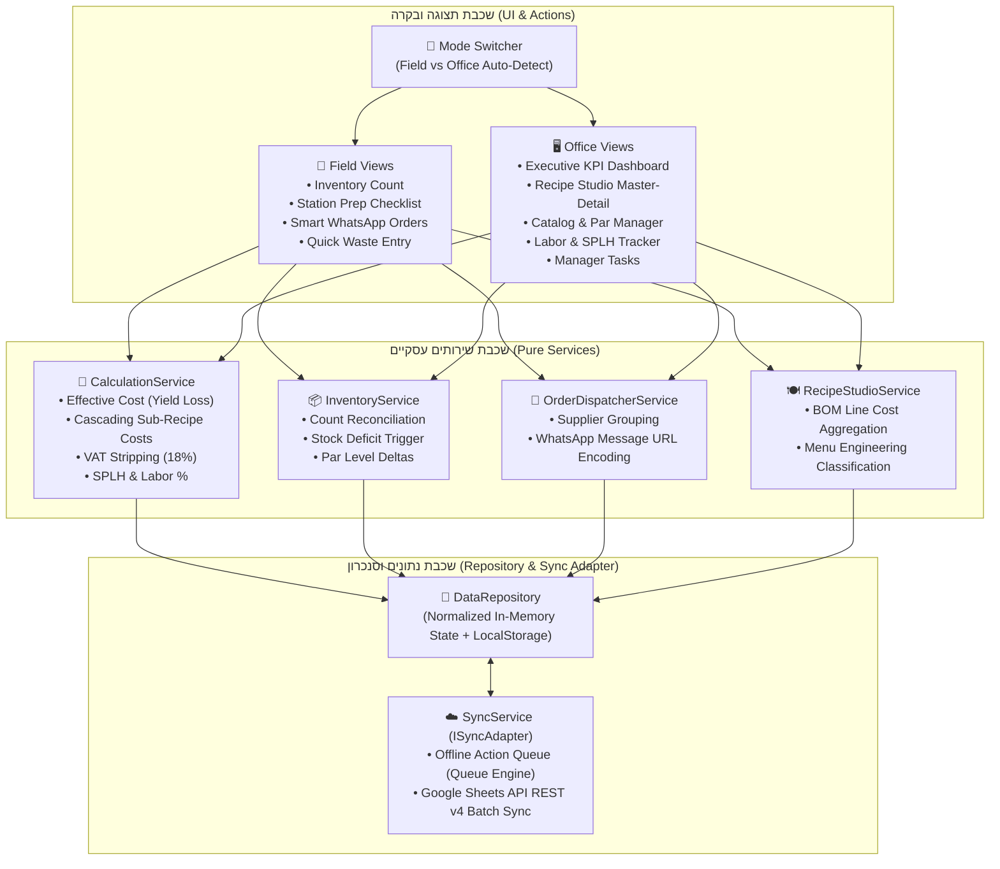
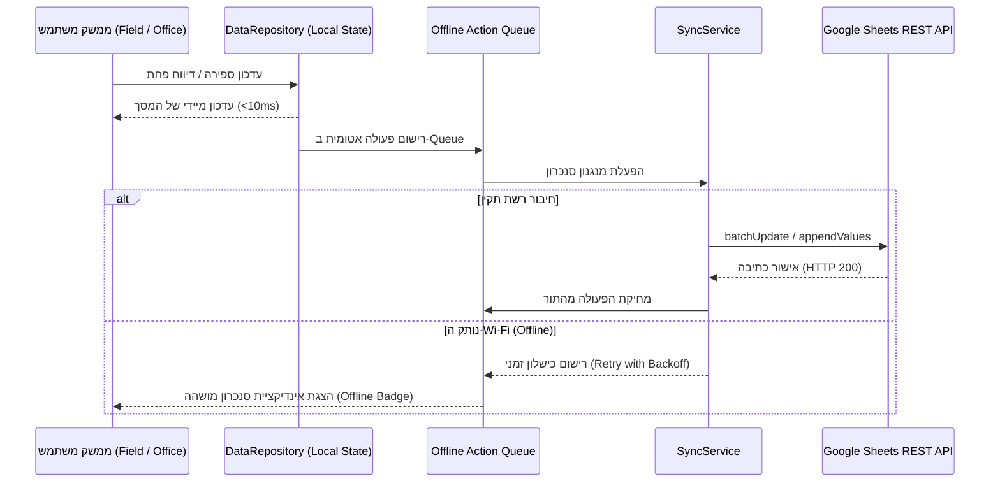

# 🏗️ מסמך ארכיטקטורת מערכת (System Design) — Kitchen OS v3.0

## Document Header
- **Document Type**: System Design Document
- **From**: agent-system-architect
- **To**: agent-software-engineer, agent-ui-ux, agent-ciso, agent-qa
- **Date**: 2026-10-27 10:20
- **Status**: Under Review (מוגש לאישור היו"ר - Gate 2.0)
- **Version**: 1.0
- **Related Documents**: [01_vision.md](01_vision.md), [02_prd.md](02_prd.md), [STATUS.md](STATUS.md), [AGENT_OPERATIONS_LOG.md](AGENT_OPERATIONS_LOG.md)

---

## 1. גישה ארכיטקטונית ומפת תפרי בידוד (Architecture & Seams Map)

המערכת בנויה כ-**Single Page Application (SPA / PWA)** רספונסיבית מודולרית המבוססת על **Clean Service Layer Architecture** (`AGENTS.md` §6). המערכת מפרידה באופן מוחלט בין שכבת התצוגה (Actions/UI Controllers) לבין שכבת השירותים העסקיים ומודול התקשורת.

### תפרי בידוד (Seams Architecture per Martin Fowler):
1. **Storage Repository Seam (`IDataRepository`):** שכבת אחסון מופשטת המאפשרת עבודה שקופה מול `localStorage` בדפדפן, ללא תלות ישירה ב-DOM או במנגנוני שמירה ספציפיים.
2. **Remote Sync Adapter Seam (`ISyncAdapter`):** מתאם תקשורת מופשט המאפשר סנכרון דו-כיווני מול Google Sheets REST API v4 / Google Apps Script Web App, לצד מתאם בדיקה מקומי (Mock Sync Adapter) לצורכי בדיקות יחידה מבודדות ב-100%.
3. **Time Provider Seam (`ITimeProvider`):** ספק שעון מוזרק המייצר חותמות זמן ISO לצורכי בדיקות דטרמיניסטיות של לוגים.



---

## 2. מודל נתונים מנורמל (Normalized Data Entities)

כדי לחסל את העומס של גיליונות מרובי טבלאות צד-בצד, המערכת מגדירה 8 ישויות מנורמלות:

### 2.1 `DB_Config` (הגדרות מערכת ותקציב)
```typescript
interface DBConfig {
  targetFoodCost: number;       // default: 0.30 (30%)
  targetLaborCost: number;      // default: 0.15 (15%)
  employerCostMultiplier: number; // default: 1.30 (עלות מעסיק)
  vatRate: number;              // default: 0.18 (18%)
  currencySymbol: string;       // default: "₪"
}
```

### 2.2 `DB_Suppliers` (ספקים)
```typescript
interface Supplier {
  id: string;                   // PK, e.g. "SUP-01"
  name: string;                 // e.g. "אשי שוק"
  category: string;             // e.g. "ירקות ופירות"
  contactName: string;          // e.g. "אשי"
  whatsappPhone: string;        // e.g. "972504008601"
  deliveryDays: string[];       // e.g. ["ראשון", "שלישי", "חמישי"]
  isActive: boolean;
}
```

### 2.3 `DB_Catalog` (קטלוג חומרי גלם מאוחד — SSOT)
```typescript
interface CatalogItem {
  id: string;                   // PK, e.g. "ITM-001"
  name: string;                 // e.g. "מנצ'גו כמהין"
  category: string;             // Enum: 'גבינות ומחלבה', 'ירקות ופירות', etc.
  supplierId: string;           // FK -> DB_Suppliers.id
  stockUnit: string;            // Enum: 'ק"ג', 'ליטר', 'יח'', 'צרור', 'ארגז'
  unitCostExclVat: number;      // עלות ליחידה לפני מע"מ (₪)
  yieldLossPct: number;         // אחוז פחת חיתוך/קילוף (0.00 - 1.00)
  effectiveCost: number;        // מחושב: unitCostExclVat / (1 - yieldLossPct)
  parLevelWeekend: number;      // תקן מלאי לסופ"ש
  reorderPoint: number;         // נקודת מינימום להזמנה
  currentStock: number;         // מלאי נוכחי מחושב
  inCountForm: boolean;         // האם מופיע בטופס ספירה בשטח
  inWasteForm: boolean;         // האם מופיע בטופס פחת מהיר
  isActive: boolean;
}
```

### 2.4 `DB_Dishes` (מנות תפריט ומתכוני הכנה)
```typescript
interface Dish {
  id: string;                   // PK, e.g. "DSH-01"
  name: string;                 // e.g. "פלטת גבינות זוגית" / "מטבל טחינה"
  dishType: 'MENU_ITEM' | 'SUB_RECIPE'; // מנת תפריט או מתכון הכנה
  category: string;             // e.g. "פלטות וגבינות", "מתכוני הכנה"
  yieldPortions: number;        // מספר מנות / יחידות תפוקה
  priceInclVat: number;         // מחיר לצרכן כולל מע"מ (0 עבור מתכון הכנה)
  priceExclVat: number;         // מחושב: priceInclVat / (1 + vatRate)
  weeklySalesQty: number;       // כמות מכירות שבועית (לחישוב מטריצת תפריט)
  prepInstructions: string;     // הוראות ביצוע וקיצוץ
}
```

### 2.5 `DB_Recipe_Lines` (מרכיבי מתכון — Bill of Materials)
```typescript
interface RecipeLine {
  id: string;                   // PK
  parentDishId: string;         // FK -> DB_Dishes.id
  componentType: 'RAW_ITEM' | 'SUB_RECIPE';
  componentId: string;          // FK -> DB_Catalog.id או DB_Dishes.id
  quantity: number;             // כמות במתכון
  unit: string;                 // יחידת מידה
  lineCost: number;             // מחושב: quantity * component.effectiveCost
  notes?: string;
}
```

### 2.6 `DB_Prep_Checklist` (צ'קליסט הכנות עמדה יומי)
```typescript
interface PrepTask {
  id: string;                   // PK
  station: 'פלטות וגבינות' | 'ברוסקטות וסלטים' | 'הכנות קרות' | 'כללי';
  prepItem: string;             // שם פריט ההכנה
  frequency: 'יומי' | 'לפני סופ"ש' | 'שבועי';
  estMinutes: number;           // זמן משוער בדקות
  doneToday: boolean;           // האם הושלם היום
  instructions: string;         // הנחיות קצרות
  linkedDishId?: string;        // קישור אופציונלי למתכון ב-DB_Dishes
}
```

### 2.7 `OPS_Manager_Tasks` (משימות ניהול משרדיות)
```typescript
interface ManagerTask {
  id: string;
  title: string;
  area: string;
  assignee: string;             // ברירת מחדל: "ישראל"
  priority: 'גבוהה' | 'רגילה' | 'נמוכה';
  dueDate: string;
  status: 'לביצוע' | 'בתהליך' | 'הושלם';
  notes?: string;
}
```

### 2.8 לוגים אופרטיביים (`LOG_Counts`, `LOG_Waste`, `LOG_Labor`)
- **`LOG_Counts`**: `countId`, `timestamp`, `itemId`, `countedQty`, `unitCostSnapshot`, `countValue`, `reporter`.
- **`LOG_Waste`**: `wasteId`, `timestamp`, `reporter`, `itemId`, `wasteQty`, `wasteReason`, `totalWasteCost`, `notes`.
- **`LOG_Labor`**: `monthId` (YYYY-MM), `salesInclVat`, `salesExclVat`, `serviceHours`, `prepHours`, `hourlyWagesGross`, `salariedGross`, `employerCost`, `laborPct`, `splh`.

---

## 3. לוגיקת חישובים ריאקטיבית (Reactive Calculation Engine)

1. **עלות אפקטיבית (Effective Raw Cost):**
   $$\text{Effective Cost} = \frac{\text{Unit Cost Excl VAT}}{1 - \text{Yield Loss Pct}}$$
2. **עלות מתכון הכנה משורשר (Cascading Sub-Recipe Cost):**
   $$\text{Sub-Recipe Portion Cost} = \frac{\sum (\text{Line Quantity} \times \text{Component Effective Cost})}{\text{Yield Portions}}$$
   כאשר רכיב הוא Sub-Recipe בעצמו, המערכת פותרת את העלות בצורה רקורסיבית מבוקרת (עם הגנת מניעת תלות מעגלית `ERR_RECIPE_CIRCULAR`).
3. **פוד-קוסט מנה (Food Cost %):**
   $$\text{Food Cost \%} = \frac{\text{Total Dish Cost}}{\text{Price Excl VAT}}$$
4. **מדד מכירות לשעת עבודה (SPLH — Sales Per Labor Hour):**
   $$\text{SPLH} = \frac{\text{Net Sales Excl VAT}}{\text{Service Hours} + \text{Prep Hours}}$$
5. **כמות מומלצת להזמנת רכש (Order Quantity):**
   $$\text{Order Qty} = \max(0, \text{Par Level Weekend} - \text{Current Stock})$$
   נוצר רק כאשר $\text{Current Stock} \le \text{Reorder Point}$.

---

## 4. ארכיטקטורת סנכרון דו-כיווני ותמיכת Offline



---

## 5. מבנה קבצי הפרויקט (`src/` Tree)

```
c:/Users/israe/Desktop/פרוייקטים/ניהול מטבח/
├── index.html                  # קובץ ה-SPA הראשי עם מבנה סמנטי של שטח ומשרד
├── design/
│   ├── tokens.json             # W3C DTCG Design Tokens
│   └── tokens.css              # משתני CSS מהודרים מקובץ הטוקנים
├── css/
│   ├── base.css                # איפוס, טיפוגרפיה (Heebo), חוקי RTL ורשת 8pt
│   ├── layout.css              # פריסת Field (Bottom Nav) ו-Office (Sidebar)
│   ├── components.css          # כרטיסים, Steppers, טבלאות, כפתורים, תגיות ומגירות
│   └── views.css               # עיצוב מודולים ספציפיים (Studio, Dashboard)
├── js/
│   ├── app.js                  # נקודת כניסה ראשית, ראוטינג ומתג Dual-Mode
│   ├── store.js                # State Management ריאקטיבי מרכזי
│   ├── seedData.js             # נתוני אתחול ריאליסטיים של יקב הבוטיק
│   ├── services/
│   │   ├── calculationService.js # מנוע חישובי פוד-קוסט, פחת, מע"מ ו-SPLH
│   │   ├── inventoryService.js   # ניהול ספירות וחוסרים
│   │   ├── orderDispatcher.js    # מחולל הודעות WhatsApp
│   │   └── syncService.js        # שכבת סנכרון מול Google Sheets REST API v4
│   └── views/
│       ├── fieldInventory.js     # מסך ספירת מלאי מובייל
│       ├── fieldPrep.js          # מסך צ'קליסט עמדות
│       ├── fieldOrders.js        # מסך הזמנות רכש חכמות
│       ├── fieldWaste.js         # מסך דיווח פחת מהיר
│       ├── officeDashboard.js    # דאשבורד 6 מדדי KPI
│       ├── officeStudio.js       # סטודיו מתכונים Master-Detail
│       ├── officeCatalog.js      # ניהול קטלוג וספקים
│       └── officeLabor.js        # בקרת לייבור ו-SPLH
├── run.bat                     # סקריפט הרצה מקומי בלחיצה אחת
├── STATUS.md                   # לוח בקרה פרויקטלי
└── AGENT_OPERATIONS_LOG.md     # יומן פעולות וטלמטריה
```

---

## 6. המלצת שער 2.0 (Architect Recommendation)
- ארכיטקטורת המערכת שלמה, נקייה מתלויות מעגליות, ומיישמת במלואה את עקרונות ה-Seams ושכבת השירותים.
- מוכנה להעברה לשלב העיצוב המפורט (`03b_ui.md` וטוקנים) ומפרט האבטחה (`03c_security.md`).
