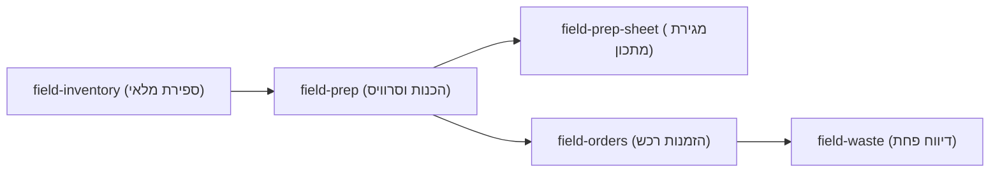

project_id: kitchen-os-field
platform: mobile-web
device_frame: iPhone 15 — 393x852
ui_language: he
direction: rtl

# UX Brief · Kitchen OS v3.0 — מצב שטח (Field Mode)

> שלב א' (Pre-Stitch UX). המסמך הזה הוא מקור האמת לפרומפטים. **אין בו החלטות פיקסל, CSS או קוד** (R69):
> הוא מגדיר *מה* כל מסך צריך להשיג ו*איזו אווירה* לבקש מ-Stitch. *איך זה נראה* נקבע ברינדור של Stitch.

## 1. הבעיה, המשתמשים וההקשר
- **מי:** שף, מנהל מטבח וטבחי פס במרכז מבקרים של יקב בוטיק.
- **מה הבעיה:** דיווחי שטח שוטפים (ספירת מלאי במקררים, מעקב הכנות לפס, הזמנות רכש מספקים ודיווח פחת) לוקחים זמן רב מדי בגיליונות מסורבלים או בממשקים עמוסים וקשים לקריאה תוך כדי עבודה.
- **הקשר שימוש:** עבודה בעמידה, תפעול ביד אחת (אגודל ימין/שמאל) כשהיד השנייה אוחזת קופסת גסטרונום או מדף מקרר, תחת תאורת ניאון חזקה במטבח או תאורה עמומה בחדר קירור, לעיתים ללא קליטת Wi-Fi יציבה.
- **מדדי הצלחה:**
  - קיצור ספירת מלאי ודיווח יומי מ-45 דקות לפחות מ-7 דקות.
  - דיווח פחת מלא ב-3 הקשות תוך פחות מ-5 שניות.
  - קריאות מוחלטת ממרחק חצי מטר (ניגודיות מעל 14:1 לטקסט ראשי ויעדי מגע של לפחות 48x48px).

## 2. דרישות (REQ)

כל דרישה מקבלת מזהה יציב. שלב ג' ממפה כל מזהה לסטטוס כיסוי (R73).

| REQ | דרישה | מקור (בריף / שאלה שנענתה / הנחה) | חזותי? |
|---|---|---|---|
| REQ-01 | הצגת כותרת עליונה קומפקטית עם שם המערכת ("Kitchen OS"), מתג מצבים ("שטח" / "משרד") וחיווי סנכרון ("מסונכרן" / "שמור מקומית") | PRD §1, 03b_ui §1 | כן |
| REQ-02 | סרגל ניווט תחתון קבוע למצב שטח עם 4 יעדים בדיוק (R45): "ספירת מלאי", "הכנות וסרוויס", "הזמנות רכש", "דיווח פחת" | 03b_ui §1 | כן |
| REQ-03 | במסך ספירת מלאי: חיפוש מהיר בעברית וסינון אופקי לפי קטגוריות ("הכל", "גבינות ומחלבה", "ירקות ופירות", "לחמים ומאפים", "יבשים ומזווה") | PRD §3.1 | כן |
| REQ-04 | במסך ספירת מלאי: כרטיסי פריטים ממוסגרים בבירור עם שם הפריט, יחידת מידה בתגית נפרדת, תקן מומלץ, וכפתורי Stepper גדולים (+/-) של לפחות 48x48px לעדכון כמות ביד אחת | PRD §3.1, R20 | כן |
| REQ-05 | במסך ספירת מלאי: כפתור פעולה ראשי יחיד (R11) בתחתית מעל סרגל הניווט: "שמור ועדכן מלאי (3 פריטים)" | PRD §3.1, R11 | כן |
| REQ-06 | במסך הכנות וסרוויס: סינון לפי עמדות ("פלטות וגבינות", "פס קר וסלטים", "טאבון ומאפים") ומד התקדמות כנה (R49) המציג משימות שהושלמו וזמן משוער נותר ("3/6 הושלמו · 40 דק' נותרו") | PRD §3.2, R49 | כן |
| REQ-07 | במסך הכנות וסרוויס: רשימת משימות הכנה עם תיבת סימון גדולה (48x48px), כמות יעד להכנה, זמן מוערך, וכפתור מידע לפתיחת מתכון והוראות | PRD §3.2 | כן |
| REQ-08 | במגירת מתכון והוראות הכנה (Bottom Sheet): הצגת שם מנת ההכנה ("מטבל טחינה"), תפוקת המתכון, רשימת מרכיבים מדויקת עם כמויות ויחידות, שלבי הכנה ממוספרים, וכפתור ראשי "סמן הכנה כהושלמה" | PRD §3.2, R30 | כן |
| REQ-09 | במסך הזמנות רכש: קיבוץ אוטומטי של פריטים בחוסר לפי ספק ("אשי שוק", "מחלבות גד"), הצגת כמות נוכחית מול תקן סופ"ש, כמות מומלצת להזמנה עם אפשרות התאמה (+/-), וכפתור ראשי "שלח הזמנה בוואטסאפ" | PRD §3.3 | כן |
| REQ-10 | במסך דיווח פחת: טופס מהיר ב-3 צעדים (בחירת פריט, הזנת כמות ב-Stepper או מקלדת, בחירת סיבה מתוך תגיות: "פג תוקף / קלקול", "שגיאת הכנה", "נפילה / שבירה", "אחר"), חישוב עלות כספית בזמן אמת ("עלות הפחת: ₪42.50") וכפתור ראשי "אשר דיווח פחת" | PRD §3.4 | כן |
| REQ-11 | עמידה מלאה בתקני מובייל ונגישות: RTL מלא בעברית (R22), יעדי מגע מינימליים 48x48px (R20), גודל טקסט גוף לפחות 16px (R44), ללא אימוג'י כאייקון (R21), וללא כרטיס בתוך כרטיס (R46) | RULES R19-R22, R44, R46 | כן |
| REQ-12 | שמירה מקומית שקופה (Offline Queue) וסנכרון אוטומטי ל-Google Sheets API v4 ברקע | PRD §2.4 | לא — לוגיקת סנכרון ושירות רקע ב-syncService.js |

## 3. משימות מפתח וזרימה
- **T1 (ספירת מלאי במקרר):** כניסה ל"ספירת מלאי" ← סינון קטגוריה "גבינות ומחלבה" ← עדכון כמויות בלחיצות `+`/`-` ← לחיצה על "שמור ועדכן מלאי" → מסכים: `field-inventory`
- **T2 (ביצוע הכנות פס וצפייה במתכון):** מעבר ל"הכנות וסרוויס" ← בחירת עמדת "פלטות וגבינות" ← פתיחת מתכון "מטבל טחינה" במגירת תחתית ← סימון ההכנה כהושלמה → מסכים: `field-prep → field-prep-sheet`
- **T3 (שיגור הזמנת רכש לספק):** מעבר ל"הזמנות רכש" ← בדיקת כמויות מומלצות לספק "אשי שוק" ← לחיצה על "שלח הזמנה בוואטסאפ" → מסכים: `field-orders`
- **T4 (דיווח פחת מהיר):** מעבר ל"דיווח פחת" ← בחירת "צ'דר אנגלית", כמות "0.5 ק"ג", סיבה "פג תוקף / קלקול" ← בדיקת עלות מחושבת "₪42.50" ← לחיצה על "אשר דיווח פחת" → מסכים: `field-waste`

## 4. פירוק למסכי מובייל

עיקרון: **מסך אחד, משימה אחת** (R42).

| screen_id | שם | מטרה (משפט אחד) | פעולה ראשית אחת | REQ | מצבים עם פריסה שונה (פרומפט נפרד) |
|---|---|---|---|---|---|
| field-inventory | ספירת מלאי מהירה | ספירה ועדכון מהיר של כמויות חומרי גלם במלאי ביד אחת לפי קטגוריות | שמור ועדכן מלאי | REQ-01, REQ-02, REQ-03, REQ-04, REQ-05, REQ-11 | אין (נגזרים בשלב ג') |
| field-prep | הכנות וסרוויס לפי עמדות | ניהול צ'קליסט ההכנות היומי לעמדה עם מעקב התקדמות וזמן נותר | סמן נבחרים כהושלמו | REQ-01, REQ-02, REQ-06, REQ-07, REQ-11 | אין (נגזרים בשלב ג') |
| field-prep-sheet | מגירת מתכון והוראות הכנה | צפייה במרכיבים המדויקים (BOM) ובהוראות ההכנה של פריט מתוך צ'קליסט ההכנות | סמן הכנה כהושלמה | REQ-07, REQ-08, REQ-11 | אין (שכבת Bottom Sheet ממוקדת) |
| field-orders | הזמנות רכש חכמות | סקירת חוסרים אוטומטית לפי ספקים ושיגור הזמנה מעוצבת ב-WhatsApp | שלח הזמנה בוואטסאפ | REQ-01, REQ-02, REQ-09, REQ-11 | אין (נגזרים בשלב ג') |
| field-waste | דיווח פחת מהיר | תיעוד זריקת חומר גלם או מנה ב-3 שלבים מהירים עם חישוב עלות כספית מיידי | אשר דיווח פחת | REQ-01, REQ-02, REQ-10, REQ-11 | אין (נגזרים בשלב ג') |

### 4.1 פירוט לכל מסך

#### field-inventory
- **אזורים (מלמעלה למטה):**
  1. Top App Bar — כותרת מותג "Kitchen OS", מתג מצבים ("שטח" פעיל / "משרד"), תגית סטטוס סנכרון ("מסונכרן").
  2. Search & Category Filter Strip — שדה חיפוש "חפש חומר גלם (למשל: מנצ'גו, חסה)..." ומתחתיו סרגל תגיות אופקי: "גבינות ומחלבה" (פעיל), "הכל", "ירקות ופירות", "לחמים ומאפים", "יבשים".
  3. Inventory Items List — רשימת שורות/כרטיסים בסגנון Editorial (ללא כרטיס בתוך כרטיס, מופרדים בקו דיו `1.5px`): כל שורה מציגה שם פריט, תגית יחידת מידה, תקן סופ"ש, ורכיב Stepper בולט (`-` כמות בטיפוגרפיה מונוספייס גדולה `+`).
  4. Sticky Primary Action Bar — סרגל תחתון מעל הניווט עם כפתור כתום-ורמיליון ראשי: "שמור ועדכן מלאי (3 פריטים)".
  5. Bottom Tab Bar — 4 לשוניות ("ספירת מלאי" פעיל, "הכנות וסרוויס", "הזמנות רכש", "דיווח פחת") עם אייקונים וקטוריים של Lucide.
- **תוכן ומיקרו-קופי סופי:**
  - כותרת משנה: `"ספירת מלאי · גבינות ומחלבה"`
  - כפתור ראשי: `"שמור ועדכן מלאי (3 פריטים)"`
- **נתונים לדוגמה ריאליסטיים:**
  - `"מנצ'גו כמהין"` · יחידה: `"ק"ג"` · תקן: `"6.0"` · כמות נוכחית: `"4.5"` (שונה, מודגש)
  - `"גאודה עיזים מיושנת"` · יחידה: `"ק"ג"` · תקן: `"5.0"` · כמות נוכחית: `"3.0"`
  - `"ברי צרפתית"` · יחידה: `"יח'"` · תקן: `"8"` · כמות נוכחית: `"2"` (תגית סטטוס `"חוסר"`)
  - `"חמאה הולנדית"` · יחידה: `"ק"ג"` · תקן: `"4.0"` · כמות נוכחית: `"4.0"` (`"תקין"`)
- **ניווט:** לשונית ראשונה בסרגל התחתון; מעבר ישיר לשאר 3 הלשוניות או למצב משרד.

#### field-prep
- **אזורים (מלמעלה למטה):**
  1. Top App Bar — זהה לכל מסכי השטח.
  2. Station Selector & Editorial Progress Header — בורר עמדות אופקי ("פלטות וגבינות" פעיל, "פס קר וסלטים", "טאבון ומאפים") ובלוק התקדמות ממוסגר: `"3 מתוך 6 הושלמו"` · `"40 דק' עבודה נותרו"`, עם פס התקדמות מילוי מימין לשמאל.
  3. Prep Checklist Rows — שורות משימה ברורות עם תיבת סימון מרובעת גדולה (`48x48px`), שם המשימה, כמות נדרשת בתגית מונוספייס, זמן הכנה מוערך, וכפתור אייקון וקטורי `"מתכון"` לפתיחת המגירה.
  4. Bottom Tab Bar — "הכנות וסרוויס" פעיל.
- **תוכן ומיקרו-קופי סופי:**
  - כותרת אזור: `"צ'קליסט הכנות לעמדה"`
  - משימות: `"חיתוך אצבעות מנצ'גו וגאודה"` (`"15 מנות · 20 דק'"`), `"הכנת מטבל טחינה ירוקה"` (`"2.5 ק"ג · 15 דק'"`), `"מילוי קופסאות פירות יבשים ואגוזים"` (`"20 יח' · 10 דק'"` — מסומן כהושלם), `"פרוסות לחם מחמצת לשמן זית"` (`"12 כיכרות · 15 דק'"`).
- **ניווט:** לחיצה על כפתור `"מתכון"` בשורת "הכנת מטבל טחינה ירוקה" פותחת את `field-prep-sheet`.

#### field-prep-sheet
- **אזורים (מלמעלה למטה):**
  1. Dimmed Background Preview — חלק עליון מציג בעמעום את מסך `field-prep`.
  2. Editorial Bottom Sheet Container — מגירה בגובה 78% מהמסך עם ידית גרירה עליונה, כותרת `"מתכון הכנה · מטבל טחינה ירוקה"`, כפתור סגירה (`X` בפינה השמאלית העליונה ב-RTL), ותגיות מידע: `"תפוקה: 2.5 ק"ג"` · `"זמן הכנה: 15 דק'"` · `"עמדה: פלטות וגבינות"`.
  3. Ingredients Table (BOM) — טבלת דיו נקייה עם קווים אופקיים דקים: שם חומר הגלם מימין, כמות ויחידת מידה במונוספייס משמאל.
  4. Preparation Steps — שלבי הכנה ממוספרים (1, 2, 3) בטיפוגרפיה קריאה (`16px`).
  5. Sheet Primary Action — כפתור רוחב מלא בתחתית המגירה: `"סמן הכנה כהושלמה"`.
- **נתונים לדוגמה ריאליסטיים:**
  - מרכיבים: `"טחינה גולמית הר ברכה"` (`"1.20 ק"ג"`), `"מים קרים מאוד"` (`"1.00 ליטר"`), `"פטרוזיליה וכוסברה קצוצה"` (`"0.15 ק"ג"`), `"מיץ לימון סחוט טרי"` (`"0.12 ליטר"`), `"מלח ים אטלנטי ושום כתוש"` (`"0.03 ק"ג"`).
- **ניווט:** סגירה או סימון כהושלם מחזירים ל-`field-prep`.

#### field-orders
- **אזורים (מלמעלה למטה):**
  1. Top App Bar — זהה לכל מסכי השטח.
  2. Orders Summary Banner — כותרת מערכתית: `"הזמנות רכש לסופ"ש"` עם תגית סיכום `"2 ספקים להזמנה · 5 פריטים בחוסר"`.
  3. Supplier Order Blocks — בלוקים ממוסגרים לפי ספק (ללא קינון כרטיסים — R46: כותרת ספק עם קו הפרדה, מתחתיה שורות הפריטים להזמנה, ובתחתית הבלוק כפתור שליחה לספק):
     - ספק 1 (ראשי ופתוח): `"אשי שוק — ירקות ופירות"` · תגית `"3 פריטים בחוסר"`.
     - שורות פריטים: שם פריט, `"מלאי: 2 | תקן: 10"`, וכמות מומלצת להזמנה עם Stepper קטן/מדויק (`"להזמנה: 8 צרור"`).
     - כפתור פעולה ראשי של הבלוק: `"שלח הזמנה בוואטסאפ לאשי שוק"`.
     - ספק 2 (מקופל/תמציתי מתחתיו): `"מחלבות גד — גבינות"` · `"2 פריטים בחוסר"`.
  4. Bottom Tab Bar — "הזמנות רכש" פעיל.
- **נתונים לדוגמה ריאליסטיים:**
  - תחת `"אשי שוק"`: `"חסה קיסר"` (`"להזמנה: 8 צרור"`), `"עגבניות שרי תמר"` (`"להזמנה: 5 ק"ג"`), `"בזיליקום טרי"` (`"להזמנה: 6 צרור"`).

#### field-waste
- **אזורים (מלמעלה למטה):**
  1. Top App Bar — זהה לכל מסכי השטח.
  2. Screen Header — `"דיווח פחת מהיר"` עם תת-כותרת `"רישום ב-3 לחיצות ועדכון אוטומטי של המלאי"`.
  3. Step 1: Item Selector — שדה בחירה ממוסגר וברור עם פריט נבחר: `"צ'דר אנגלית מיושנת"` (`"מחיר עלות: ₪85.00 לק"ג"`).
  4. Step 2: Quantity Stepper — בורר כמות מרכזי ובולט מאוד: כפתור `-` גדול, תצוגת מספר ענקית `"0.5"` עם תגית `"ק"ג"`, וכפתור `+` גדול, לצד כפתורי קיצור (`"+0.25"`, `"+0.5"`, `"+1.0"`).
  5. Step 3: Reason Chips — 4 תגיות בחירה גדולות (`48px` גובה): `"פג תוקף / קלקול"` (נבחר, ממוסגר בדיו כחול קובלט), `"שגיאת הכנה"`, `"נפילה / שבירה"`, `"החזרת לקוח"`.
  6. Live Financial Impact Ticket — בלוק בסגנון קבלה/בון ממוסגר בקו מקווקו: `"עלות הפחת המחושבת: ₪42.50"` · `"יתרת מלאי לאחר הפחתה: 2.5 ק"ג"`.
  7. Primary Action Button — כפתור ראשי בולט: `"אשר דיווח פחת"`.
  8. Bottom Tab Bar — "דיווח פחת" פעיל.

## 5. מצבי מסך (R12)

לכל מסך מוגדרים חמשת המצבים המחייבים (Default, Loading, Empty, Partial-Error, Fatal-Error).

| screen_id | loading | empty | partial-error | fatal-error | ירונדר ב-Stitch? |
|---|---|---|---|---|---|
| field-inventory | שלד שורות (Skeleton) בגוון נייר אפרפר עם קווי מתאר דקים | שני מצבים (R55): 1. מסד ריק: "טרם הוגדרו פריטים בקטלוג" + מעבר לקטלוג; 2. אפס תוצאות חיפוש: "לא נמצאו פריטים התואמים לחיפוש" + כפתור "נקה סינון" | באנר ענבר ממוסגר בראש הרשימה: "המערכת במצב לא-מקוון; הספירה נשמרה במכשיר ותסונכרן אוטומטית" + כפתור "נסה לסנכרן עכשיו" | הודעת שגיאה ממוסגרת: "לא ניתן לטעון את נתוני המלאי מהזיכרון המקומי" + כפתור "טען מחדש" | default |
| field-prep | שלד מד התקדמות ו-4 שורות משימה | "כל משימות ההכנה לעמדה זו הושלמו להיום" + כפתור "הצג משימות שהושלמו" | חיווי מקומי ליד משימה: "שמור במכשיר — טרם סונכרן לענן" + כפתור ניסיון חוזר | "שגיאה בטעינת תוכנית ההכנות היומית" + כפתור "טען מחדש" | default |
| field-prep-sheet | שלד טבלת מרכיבים והוראות בתוך המגירה | "לא הוגדרו מרכיבים למתכון הכנה זה" + כפתור "סגור מגירה" | "מחיר עלות חלקי חסר; כמויות המתכון זמינות במלואן" | "לא ניתן לטעון את פירוט המתכון" + כפתור "נסה שוב" | default |
| field-orders | שלד 2 בלוקים של ספקים | "כל המלאי תקין מעל נקודת ההזמנה — אין חוסרים לרכש כעת" + כפתור "עבור לספירת מלאי" | באנר בתוך בלוק ספק: "חסר מספר טלפון עבור ספק זה" + כפתור "העתק טקסט הזמנה ללוח" | "שגיאה בחישוב המלצות הרכש מול תקני הסופ"ש" + כפתור "טען מחדש" | default |
| field-waste | מצב טעינה בכפתור האישור ("רושם פחת...") | N/A — מסך טופס הזנה שלעולם אינו מציג רשימה ריקה כמצב ראשי | הודעת שדה ממוסגרת: "הכמות שהוזנה חייבת להיות גדולה מאפס" עם שמירת הפריט והסיבה שנבחרו (R54) | "כשל בשמירת דיווח הפחת — הנתונים שהזנת שמורים בטופס" + כפתור "נסה לשמור שוב" | default |

## 6. כיוון חזותי (קלט ל-DESIGN DNA)

- **אווירה (4 תארים) ולמה מהבריף (R26, R63):**
  1. **Swiss Kitchen Editorial** — השראה מכרטיסי בון (Kitchen Tickets) מודרניים וספרי בישול מקצועיים (כמו Noma/Phaidon): גריד גלוי עם קווי הפרדה של דיו (`1.5px`), היררכיה טיפוגרפית חדה ללא צללים מרוחים. נובע ישירות מהצורך של טבח לקרוא כמויות ויחידות מידה בשבריר שנייה תחת תאורת מטבח חזקה.
  2. **Ultra-Legible Daylight** — ניגודיות מקסימלית של שחור דיו על נייר כותנה בהיר-חמים, המונעת סנוור של לבן בוהק מדי ומבטיחה יחס ניגודיות של מעל 15:1.
  3. **Tactile Precision** — כפתורי Stepper ותיבות סימון ממוסגרים וגדולים (`48x48px`) עם ספרות מונוספייס בולטות (`22px–24px Bold`) שמרגישים כמו לחצנים פיזיים במכשיר שקילה מקצועי.
  4. **Zero-Clutter Operational** — אפס קישוטים, אפס גרפים דקורטיביים במובייל, אפס כרטיסים מקוננים (R46).
- **תפקידי צבע מבוקשים (הצעה ל-Stitch):**
  - רקע בסיס (Canvas): `Cotton Paper #F8F7F4`
  - משטח שורות ובלוקים (Surface): `Crisp White #FFFFFF`
  - גבולות וקווי גריד (Structural Ink Border): `Warm Stone Ink #D6D3C9` וקווי הדגשה `Obsidian Ink #0F1115`
  - טקסט ראשי (Primary Ink): `Obsidian Ink #0F1115`
  - טקסט משני (Secondary Ink): `Slate Charcoal #4B5563`
  - הדגשה ראשית לפעולה (Primary Action Accent): `Chef Vermilion Orange #EA580C` (עם טקסט לבן חד `#FFFFFF`)
  - הדגשה משנית / מצב נבחר (Editorial Selection Accent): `Chef Apron Cobalt #1D4ED8`
  - צבעי סטטוס (תמיד עם תגית טקסט ואייקון — R24): תקין `Forest Green #15803D`, אזהרה `Amber Ochre #B45309`, חוסר/חריגה `Crimson Red #B91C1C`.
- **טיפוגרפיה מבוקשת:**
  - כותרות וטקסט ממשק בעברית: `Rubik` או `Heebo` (משקלים 500, 600, 700).
  - כמויות, מחירים, יחידות ומדדים: `JetBrains Mono` / `Rubik` עם `tabular-nums` בגודל בולט (`20px–26px Bold`).
- **חומר / איור / תנועה:** זכוכית: **לא** (אטום וחד לחלוטין) · איור: **לא** · תנועה דקורטיבית: **לא** (תגובת לחיצה מיידית של 120ms בלבד).
- **רשומות טעם שנבדקו (DESIGN_LOG §5):** אין רשומות גלובליות; בחירת היו"ר לפרויקט זה היא כיוון ג' (Swiss Kitchen Editorial).
- **Avoid (אנטי-גנריות ספציפית לבריף — R36):**
  - ללא גרדיאנטים סגולים/כחולים של AI, ללא אפקטי Glassmorphism מטושטשים, ללא צללים רכים ומרוחים (`drop-shadow` עמוקים), ללא כרטיס בתוך כרטיס (R46), ללא אימוג'י בתור אייקונים (R21), ללא מספרי דמה באנגלית או Lorem Ipsum.
- **וריאנטים לחקירה (אופציונלי):** אין.

## 7. הנחות ושאלות פתוחות
- כל שלוש שאלות המיקוד (היקף מצב שטח, בחירת כיוון Swiss Kitchen Editorial, והפעלה עצמאית מול Stitch MCP על גבי Git Worktree) נענו ואושרו על ידי היו"ר.

